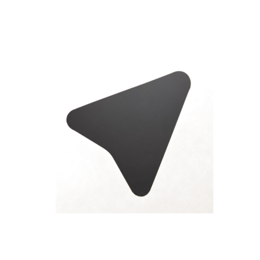

<p align="center">
  
</p>

<h1 align="center">✈️ Zenigram</h1>

<p align="center">
  <b>Эстетичный, быстрый и продуманный Telegram-клиент для Android с акцентом на крафтовый дизайн, плавность Material 3 и свободу кастомизации.</b>
</p>

<p align="center">
  <a href="https://github.com/Vechoix/Zenigram/releases/latest"></a>
  <a href="https://github.com/Vechoix/Zenigram/releases"></a>
  
  
</p>

---

## 🌟 О проекте

**Zenigram** — это открытый форк Telegram для Android, созданный для тех, кто ценит визуальную гармонию, чистоту интерфейса и внимание к деталям. Мы объединили стабильность официального клиента с эстетикой крафтовой бумаги, японского минимализма и современными возможностями Material You.

---

## ✨ Ключевые возможности

### 🎨 Zeni Theme Studio (Студия тем)
- **Мягкий волновой слайдер**: плавная длинная волна регулировки скругления углов сообщений в стиле Material 3 / Google Play (без резких зубцов).
- **Природная цветовая палитра**: понятные и гармоничные пресеты (Песочный, Шалфейный, Лавандовый, Мятный, Коралловый, Графит, Оливковый и др.).
- **Полноценный Color Picker**: пункт *«Свой цвет (Палитра)...»* позволяет выбрать любой оттенок HEX/RGB для акцента приложения и пузырьков чата.
- **Мгновенное применение темы**: интерфейс и все экраны обновляются в ту же секунду без перезахода.
- **Dynamic Monet**: полноценная интеграция с палитрой обоев на Android 12+.

### 🖋️ Типографика и шрифты
- Фирменный мягкий шрифт **Comfortaa** с аккуратными скруглениями.
- Гибкая область применения: возможность применить шрифт ко всему приложению или только к системным элементам (оставив чаты со стандартным шрифтом).
- Интерактивная карточка мгновенного предпросмотра заголовков и навигации.

### ⭕ Видеосообщения (Кружочки)
- **Симметричное центрирование**: кнопки переключения камеры, быстрого зума и вспышки идеально выровнены.
- **Тактильный отклик и анимации**: плавные scale-анимации на каждое касание.
- **Умная полоска зума**: открывается прямо на месте кнопок управления, а сами кнопки плавно скрываются, освобождая полный обзор.
- **Быстрый зум**: быстрое переключение 1x / 2x / 5x в один тап.

### 👻 Приватность и режим «Призрак»
- Чтение входящих сообщений и историй без отметки о прочтении.
- Скрытие статуса набора текста («печатает...»).
- Снятие запрета на скриншоты в защищённых каналах и секретных чатах.
- Полное отключение аналитики и внешних трекеров.

### 📱 Фирменные адаптивные иконки
- Настоящие текстурированные иконки на крафтовой бумаге с мягкими тенями без белых артефактов на любых лаунчерах (Samsung One UI, Pixel Launcher, MIUI, Nova и др.).
- Стили: **Крафт** (фирменный), **Тёмный** и **Монохром**.
- Мгновенная синхронизация и сброс кэша Android Launcher при выборе стиля.

### 🔄 Встроенный OTA-апдейтер
- Проверка и установка новых версий прямо из приложения в один клик напрямую из GitHub Releases.

---

## 📲 Скачать

Последняя стабильная версия с официальной подписью ключом всегда доступна в разделе релизов:

👉 **[Скачать Zenigram (GitHub Releases)](https://github.com/Vechoix/Zenigram/releases/latest)**

---

## 🛠️ Сборка из исходного кода

### Требования
- JDK 17 или 21
- Android SDK (API 35, Build-Tools 35.0.0, NDK r27+)
- PowerShell (Windows) или Bash (Linux/macOS)

### Инструкция по сборке

1. Клонируйте репозиторий:
   ```bash
   git clone --recursive https://github.com/Vechoix/Zenigram.git
   cd Zenigram
   ```

2. Соберите релизный APK:
   ```powershell
   powershell -ExecutionPolicy Bypass -File .\build_release.ps1
   ```
   *Собранный и подписанный APK появится в папке `APKs/Zenigram-1.0.4-arm64-v8a.apk`.*

---

## 🛡️ Безопасность и открытость

Zenigram распространяется под свободной лицензией **GNU GPL v2/v3**. Приложение не содержит рекламы, скрытых подписок, сторонних трекеров и вредоносных модулей. Каждый билд подписывается официальным релизным ключом и проходит проверки Google Play Protect.

---

<p align="center">
  <b>Zenigram. Спокойствие и эстетика в каждом пикселе.</b>
</p>
